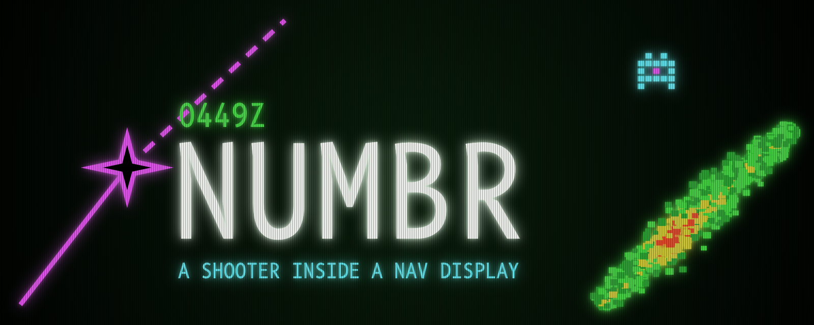

# NUMBR

A shooting game played inside a cockpit navigation display, rebuilt from a photo of a real one taken at 0449Z near the NUMBR waypoint.

Weather radar returns drift past on the wind. Pixel aliens come in waves; shoot them apart pixel by pixel until you hit the magenta core. Keep out of the red cells. Every hit rewinds the tape.

**[Play NUMBR](index.html)**

Hold to fire, drag sideways to turn. On a keyboard: arrow keys turn, space fires, P pauses, M mutes.

The game is one self-contained HTML file with no build step. The only outside resource is the B612 Mono and VT323 fonts from Google Fonts.
